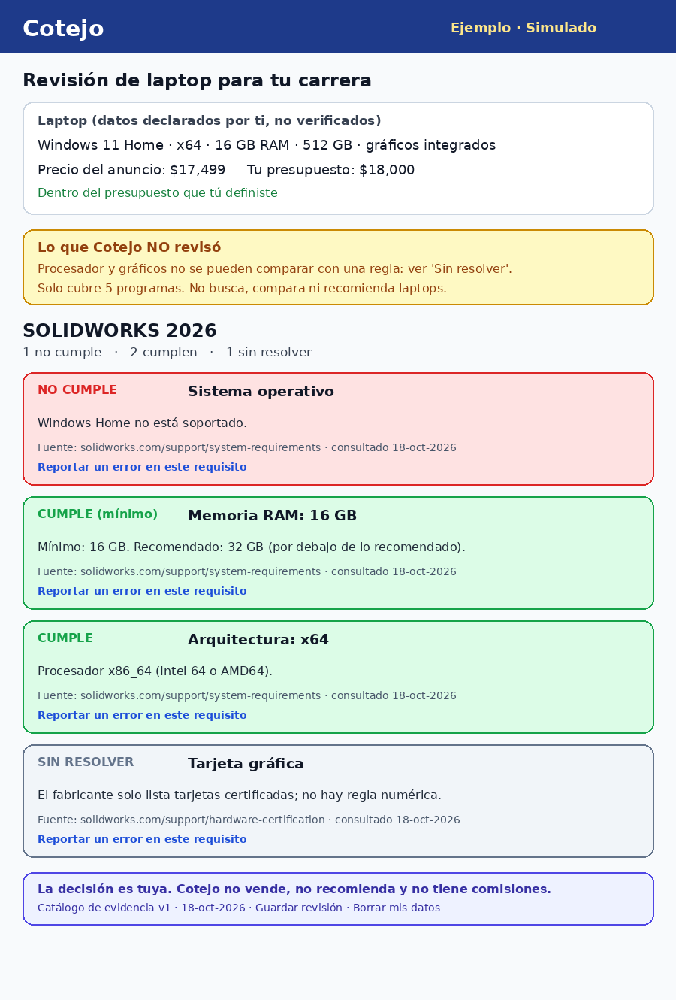
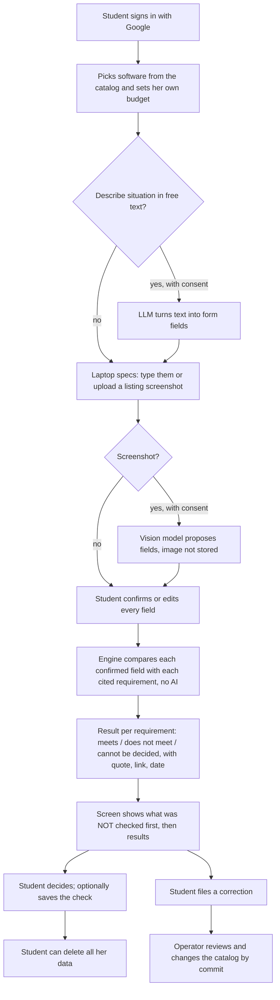
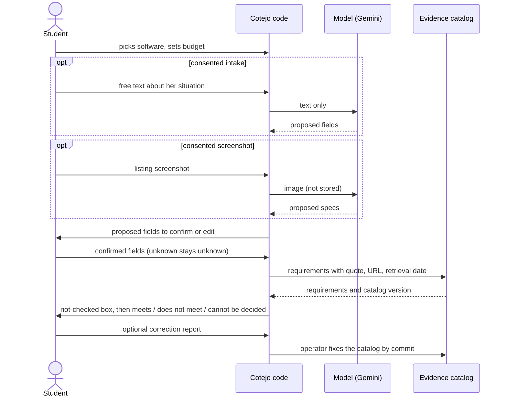

# PACKET: Cotejo

Week 10 · Business Bending · Chapter 9, Isle of Happiness
**Emilio Gomez Gonzalez** · role TECHNOLOGIST · Team 8 · declared vacuum: **Regret Prevention: independent, evidence-based laptop compatibility verification for Mexican university students** (Team 8 Blueprint, 18-10-2026). My declaration: *build a deterministic, source-backed laptop compatibility checker; honors Condition 1.*

This file was written before any code (see the commit table in section 12).

## 1. Problem, in my words

Chapter 9's harm is an optimizer that decides what is good for you and leaves you no say. In Mexican retail the buyer's side of the table is empty: every tool that "personalizes" serves the seller's variable, which is conversion. My team did not try to prove that personalization makes people decide worse (the Blueprint says plainly that it has not been proven). We took the smallest slice where a wrong decision can be checked against a published fact: a student buys a laptop for a degree that needs specific software.

The facts that make this checkable are in the software vendors' own requirement pages, which I read on 18 October 2026. They are dense, and some of them contain traps that a spec sheet on a store listing never mentions. SOLIDWORKS lists Windows as its only client platform, says Windows Home editions are not supported and says Macs running Windows through Boot Camp are not supported. Adobe Premiere lists Windows 11 version 24H2. Visual Studio 2022 does not support Windows 10 on ARM, and its Python and data-science workloads are not supported on ARM at all. MATLAB on a Qualcomm Snapdragon laptop runs through emulation and some capabilities are not supported.

What I do not have: a verified count of how many Mexican students buy a laptop that cannot run their software, or how much it costs them. Return-rate statistics do not establish it (the Blueprint says so, and my own Brain Bending work found the headline return figure was a vendor claim). So this packet makes no claim about the size of the problem. It claims only that the requirement facts exist, are hard to read, and can be compared with a laptop's specs by a program that shows its sources. The evidence about the user is the USER's job in this team (David's checklist and comprehension test); I will use it and I will not invent it.

## 2. Exact user

**Valeria, 18** (an invented archetype, not a real person). First semester of industrial design or civil engineering at a public university. Her family has put aside a budget she sets herself; in the demo it is MXN 18,000. Her program tells her she will need AutoCAD and SOLIDWORKS. She reads laptop listings on her phone, does not know what "ARM", "Windows Home" or "unified memory" mean, and will not ask a salesperson because she does not want to look unprepared. She gives up silently when a screen confuses her.

## 3. Success definition

Before this module closes: a signed-in student picks software from the catalog, enters a budget and the price of a listing she is looking at, enters the laptop's specs by typing them or by uploading a screenshot of the listing and confirming every extracted field, and gets one result per requirement (meets, does not meet, cannot be decided), each with the vendor's own words, a link and the date the evidence was read. The screen shows what was not checked before it shows any result. She can file a correction on any requirement, save the check and delete all her data.

## 4. Mockup

`docs/mockup.png`: the results screen for SOLIDWORKS on an example laptop with Windows 11 Home. Note on how it was made: this session had no image-generation model, so the screen was described in words and then drawn with a script from that description. It is a mockup of intent, not a screenshot of the product. The laptop, price and budget are invented and the screen carries the label "Ejemplo · Simulado".

## 5. The world's best attempt (benchmark)

The best existing solution on Earth for this need is **Can You RUN It** (System Requirements Lab): a web service that compares a PC's components with a product's minimum and recommended requirements and suggests what to upgrade; its site claims a library of more than 13,000 to 18,000 games (the figure varies between its pages). It is built around a detection program that scans a machine you already own, and that program runs on Windows only.

Mine differs or localizes in four ways. (1) The buyer does not own the laptop yet, so there is nothing to scan: she declares the specs and confirms each one, and every field is labeled "declared by you". (2) It covers professional and engineering software whose requirements need to be quoted, so every verdict carries the vendor's exact wording, link and the date I read it. (3) When a requirement cannot be turned into a rule (for example "8 logical cores" against a processor model name, or "certified graphics cards"), the result is "cannot be decided" and never a guess. (4) It is in Spanish, uses pesos and the student's own budget, and has no affiliate links.

Two other global examples from the Blueprint, with what they do and do not teach. **Zalando** (Germany) says its size advice reduced size-related returns by 10% against items without it (Zalando's own figure; I found no independent check). It predicts fit from product data and customer data, so Cotejo copies its narrowness (one concrete decision) but not its prediction. **Which?** (UK) tests laptops in its own lab and says its testers buy the laptops they review, but its pages also say it can earn a commission when a reader buys through a retailer link. That is the opposite of Condition 5, so Which? is a model for independent testing, not for independent funding.

## 6. The long view (3 years)

If this slice works, Cotejo becomes the Spanish-language, source-cited requirements layer for students and first-time buyers: more software, more platforms, and a public changelog of every correction, so that universities can point to it instead of a PDF list. The load-bearing walls are the evidence catalog with a source on every claim and the rule that missing information is never treated as incompatibility. It stays independent: if it ever takes money, the money cannot touch a verdict.

## 7. Team Blueprint conditions and how this build honors them

| # | Condition (Team 8 Blueprint) | Design decision in Cotejo |
|---|---|---|
| 1 | Evidence reliability: every verified claim has a traceable, reliable source and can be corrected; no invented specs, unsupported labels or fabricated confidence scores | The catalog is code in the repository. Every requirement stores the vendor, product, platform, field, minimum or recommended, value, the exact vendor quote, the URL and the retrieval date. A validation script fails the build if any entry lacks one. Corrections are filed by users and fixed by a reviewed commit; every saved check stores the catalog version it used. No confidence score exists anywhere. |
| 2 | **Shadow clause: buyer autonomy.** Students define and revise requirements, budgets and decisions; no inferred priorities, emotional manipulation, unauthorized budget increases, automatic purchases or coercive restrictions | The student picks the software and sets the budget; Cotejo never infers either. There are no purchase links, no urgency or scarcity wording and no laptop suggestions. A result never blocks anything. The model can only propose field values and a field is used only after the student confirms it. A wording scan (as in last week's build) fails the build on pressure language. |
| 3 | Visible uncertainty: separate compatible, incompatible and unresolved; disclose catalog limits and missing evidence; disclose that affordable or refurbished alternatives are out of scope; preserve a no-match outcome | Three states only. The "what I did not check" box comes before any result. A requirement with no value for the student's platform says "no evidence loaded", which is different from "does not meet". The screen states that Cotejo does not search laptops and knows nothing about refurbished or used options, and a laptop that meets nothing simply gets that answer. |
| 4 | Operational value: compare the checker with a manual checklist; add technology, including AI, only if it shows meaningful benefit | The checker works completely without AI, from a typed form. The LLM is an optional intake helper and the vision reader is optional; each check logs whether they were used and how many fields the student had to correct afterwards. That log is the incremental-benefit evidence; at this stage it is a handful of test runs, so I will report counts and make no claim of benefit. |
| 5 | Independent governance: funding cannot influence results; no referral commissions, unnecessary personal-data retention or undisclosed sharing with sellers; document operating costs; require payer evidence before claiming viability | No affiliate links, ads or seller data. Screenshots are processed and discarded; only the confirmed fields and the verdicts of a saved check are stored, and only for the signed-in student, with delete-all. Operating cost today is MXN 0 on free tiers (Vercel Hobby, Supabase free, Gemini free tier), but the real cost is the manual work of keeping the catalog current, which the Operator's workflow tracks. I make no commercial-viability claim: there is no payer evidence. |

## 8. Scope cut: what I am NOT building this week

- No laptop search, ranking, price tracking or recommendation of any kind (forbidden zone, and Condition 2).
- No store links, no affiliate links, no retailer integration. A study reported by El Economista (via Ecosistemas Startup, a secondary source) found that 3 of 14 Mexican retailers blocked AI agents outright and the other 11 had no automatable purchase path, so I do not try to read listings automatically.
- No CPU or GPU benchmark database. Those comparisons come back "cannot be decided" with the vendor's wording.
- Five titles only, and only the platforms where I could read the vendor's page. Anything else says "no evidence loaded".
- No virtual machines, emulation or Boot Camp reasoning beyond what the vendor page itself states.
- No payments, no admin console, no storing of screenshots.

## 9. Flow: flowchart

## 10. Flow: who does what (swimlane)

More than one actor touches the process: the student, the code, the optional AI model and the evidence catalog.

## 11. Architecture and stack (Dragon Stack)

| Layer | Choice | Why / Dragon Stack role |
|---|---|---|
| Frontend | Next.js App Router, Tailwind | Same proven base as last week's build |
| Auth | Supabase Auth, Google OAuth | Security floor: saved checks and AI features sit behind sign-in |
| Database | Supabase Postgres with RLS on every table | A student sees only her own rows |
| LLM | Google Gemini API (free tier), server side only, only with consent | Dragon Stack element 1. Optional intake helper that turns free text into form fields. Never decides, never writes to the verdict |
| User-constraint data | The student's software list, budget, listing price and confirmed specs | Dragon Stack element 2. The checks are run against her own constraints |
| Vision | Gemini image input on a listing screenshot | Dragon Stack element 3. Proposes spec fields; the student confirms each one; the image is not stored |
| Evidence catalog | A versioned TypeScript data file with a validator | Condition 1. Reviewed by commit, not editable by the model |
| Engine | Pure functions with unit tests | Deterministic comparison, no AI inside |
| Tables | checks, corrections, consents | No profile, no score, no per-person label by design |
| Hosting | Vercel (Hobby) | Free tier; API key only in environment variables |

Free-tier note: Google's free Gemini tier may use submitted content to improve its products (confirm the current terms). That is why AI features are opt-in and labeled, screenshots are never stored by Cotejo, and the demo uses invented laptops only.

### Security floor, planned before coding

| Floor item | Plan |
|---|---|
| No secrets in code or repo | Only the public Supabase URL and publishable key and the Gemini key, set as Vercel environment variables |
| Auth for personal data | Supabase Auth with Google sign-in; middleware redirects anonymous visitors. The evidence catalog page is public because it contains no personal data |
| Row Level Security | On for all three tables, policies scoped to the signed-in student |
| Input validation | Every form validated on the server (length, type, allow-lists); screenshots limited by type and size; free text limited in length; model output parsed into a fixed schema and discarded if malformed |
| No real personal data | Demo laptops and students are invented and labeled |

## 12. Test plan

**Mechanical pass.** Engine tests for each rule kind (numeric minimum, allowed operating systems, denied editions, allowed architectures, and "cannot be decided" notes); tests that an unknown field never produces a failure; tests that a platform with no evidence says "no evidence loaded"; a contradiction test (two catalog entries disagreeing on the same field are flagged, not silently resolved); a catalog validator (no entry without quote, URL and date); a wording scan against pressure language and purchase links; a check that the model's output is never read by the engine before confirmation. Then find at least one bug on the live URL, fix it and redeploy.

**Persona test (Layer 1).** Valeria (18, first-year design student, phone-only, does not know the jargon, gives up silently) walks the live screens from a fresh chat, narrating where she hesitates. Log every confusion and fix the worst one.

### Evidence that the packet came before the code

The first commit in the repository is this packet; every code commit comes after it (the commit table is filled in at the end of the build, from `git log`).

## Appendix: sources read for the catalog (all on 18 October 2026)

- AutoCAD 2026 system requirements (Autodesk support, page dated 7 Aug 2026)
- MATLAB R2026b system requirements for Windows (MathWorks)
- SOLIDWORKS system requirements (SOLIDWORKS; page metadata dated 2024)
- Adobe Premiere system requirements, versions 26.0 to 26.5.2 (Adobe)
- Visual Studio 2022 system requirements (Microsoft Learn, updated 1 Apr 2026)
- Benchmarks: Can You RUN It (systemrequirementslab.com), Zalando corporate pages on size advice, Which? laptop pages

Figures not independently verified are labeled as such where they appear.
